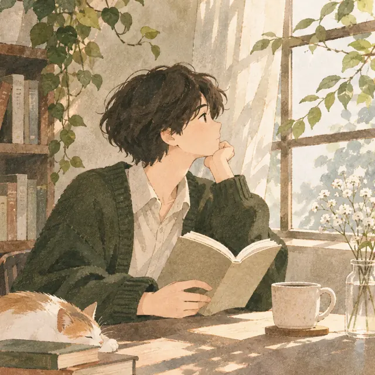

> **演示文章**：本篇仅展示博客的阅读笔记排版，正式发布前请替换。

阅读最有意思的时刻，或许发生在合上书之后。

## 一本书，三个问题

不妨尝试在每篇读书笔记里回答三个问题：

1. 作者真正想讨论的是什么？
2. 哪一段让我停下来想了一会儿？
3. 它有没有改变我观察日常的方式？

不必把答案写得很长。有时，三行诚实的感受，比三页漂亮的摘抄更重要。

## 留下自己的声音

*图像展示：文章中可以这样插入图片；以后可直接在 Pages CMS 后台上传照片。*

引用可以帮助回忆，但笔记应该有自己的声音。可以不同意作者，可以暂时不明白，也可以留一处空白，等以后再来读。

> **这里可以插入引用、图片和小标题。** Pages CMS 支持可视化编辑，不需要手写 Markdown。

